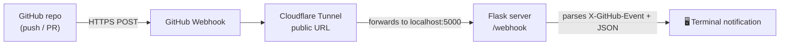

<div align="center">

# 🔔 GitHub Commit Notifier

**Real-time GitHub push and pull request notifications, printed straight to your terminal.**

A lightweight Flask webhook server, exposed to the internet through a Cloudflare Tunnel, so you never have to refresh a repo page to see what changed.


[](LICENSE)

</div>

---

## Overview

Every time something happens on a watched repository, GitHub sends an event payload to this server. The server pulls out what matters (who pushed, which branch, the commit messages, the PR title) and prints a clean notification the moment it arrives.

```
============================================================
🔔 NEW PUSH EVENT — 2026-09-07 14:32:10
============================================================
Repository : your-username/github-commit-notifier
Branch     : main
Pushed by  : your-username
Commits    : 1
------------------------------------------------------------
  [a1b2c3d] Add error handling to webhook route  (by Your Name)
============================================================
```

### Supported events

| Event | What gets printed |
|---|---|
| `push` | Repository, branch, pusher, commit count, and each commit's short SHA, message and author |
| `pull_request` | Action (opened, closed, reopened…), PR number, title and author |
| `ping` | Confirmation that the webhook is connected |
| Anything else | The event type, so nothing is dropped silently |

---

## How it works



GitHub can't reach `localhost` directly, so the Cloudflare Tunnel gives the local server a public HTTPS URL without opening ports or setting up a cloud server.

| Component | Role |
|---|---|
| **Python + Flask** | Receives and parses webhook payloads on `/webhook` |
| **GitHub Webhooks** | Sends event data whenever something happens on the repo |
| **Cloudflare Tunnel** | Exposes the local server to the internet. Quick tunnels need no account |

---

## Getting started

### Prerequisites

- Python 3.8+
- Admin access to a GitHub repository (to add a webhook)
- [cloudflared](https://github.com/cloudflare/cloudflared/releases/latest)

### 1. Clone and install

```bash
git clone https://github.com/Hafsa-Anwar65/github-commit-notifier.git
cd github-commit-notifier
pip install -r requirements.txt
```

### 2. Run the server

```bash
python app.py
```

```
Starting GitHub Commit Notifier...
Local URL: http://localhost:5000/webhook
```

Leave this terminal running.

### 3. Start a Cloudflare Tunnel

In a second terminal:

```bash
cloudflared tunnel --url http://localhost:5000
```

Copy the public URL it prints, which looks like `https://your-random-subdomain.trycloudflare.com`.

> **Note:** quick tunnels get a new URL every time `cloudflared` restarts. If you restart it, update the webhook URL on GitHub.

### 4. Add the webhook on GitHub

1. Open your repository → **Settings → Webhooks → Add webhook**.
2. **Payload URL:** your tunnel URL plus `/webhook`, for example `https://your-random-subdomain.trycloudflare.com/webhook`.
3. **Content type:** `application/json`.
4. **Events:** choose **Pushes** and **Pull requests**.
5. Click **Add webhook**.

GitHub immediately sends a `ping`, and your terminal should show:

```
✅ Webhook successfully connected! GitHub sent a ping event.
```

### 5. Test it

Push a commit or open a pull request, and watch the notification appear in your terminal.

---

## Project structure

```
github-commit-notifier/
├── app.py              # Flask server and event formatters
├── requirements.txt    # Python dependencies
├── .gitignore          # Keeps local environment files out of the repo
└── README.md
```

---

## Troubleshooting

| Problem | Likely cause |
|---|---|
| Nothing prints in the terminal | The Payload URL is missing `/webhook`, or the tunnel URL changed after a restart |
| `405` in GitHub's delivery log | The request hit `/` instead of `/webhook` |
| `ModuleNotFoundError: No module named 'flask'` | Dependencies went into a different Python. Try `python -m pip install -r requirements.txt` |
| Cloudflare Tunnel won't connect | Start `python app.py` first, since the tunnel needs something listening on port 5000 |

---

## Security notes

This is a learning project meant for local use. Before running it for anything long-lived:

- **Keep Flask's debug mode off** whenever the server is reachable through a tunnel.
- **Verify webhook signatures.** Set a secret on the GitHub webhook and check the `X-Hub-Signature-256` header, so only GitHub can trigger notifications.

## Roadmap

- [ ] Verify GitHub's webhook signature (`X-Hub-Signature-256`)
- [ ] Send notifications to Slack or Discord as well as the terminal
- [ ] Log events to SQLite for history
- [ ] Handle more event types such as `issues` and `release`

---

## Why I built this

I wanted to understand how GitHub webhooks, tunnels and a receiving server connect end to end, not just in theory but wired together and tested with a real push. It's a small project, but I set up and debugged every piece of it myself: the webhook, the tunnel and the parsing logic.

## Author

**Hafsa Anwar**, AI & Automation Engineer

[Portfolio](https://hafsaanwar.dev) · [LinkedIn](https://www.linkedin.com/in/hafsa-anwar-53b251313/) · [GitHub](https://github.com/Hafsa-Anwar65)
